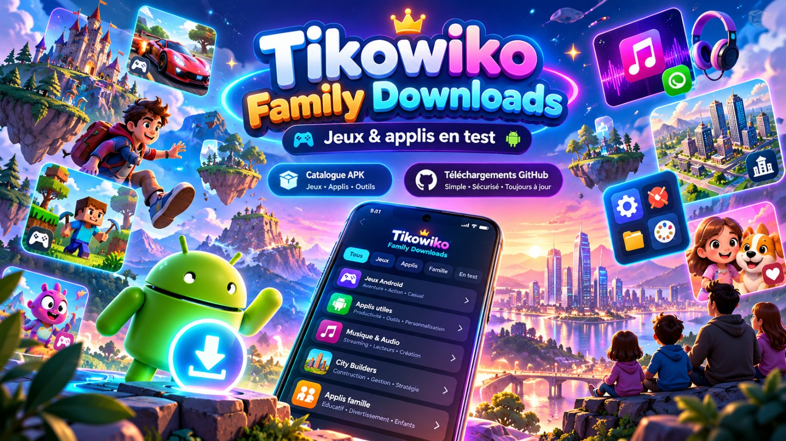

# 🎮 tikowikoFamily

### Jeux & applications Android

  

**Créateur : tikowikoFamily**  
**Contact : mrgamerdu84@gmail.com**

---

> 🔒 **Le code source n’est pas public.** Les projets restent dans des dépôts privés. Ce dépôt public sert de vitrine et de page officielle de téléchargement des APK de test.
>
> 🆓 **Pour le moment, tous les jeux et applications proposés ici sont gratuits et sans publicité.** Aucun paiement n’est nécessaire actuellement. À l’avenir, certains jeux pourront éventuellement utiliser un système de cœurs ou de crédits à financer pour continuer à jouer, mais ce système n’est pas encore actif.

**29 projets référencés · 0 passés par Lovable à vérifier · 0 en réflexion · 1 en test développeur · 2 en développement actuel · 2 en correction · 1 sur Google Play Test · 1 disponibles uniquement sur GitHub · 24 indisponibles · 0 téléchargements APK**

> ⚠️ Certaines APK sont encore en développement et peuvent donc contenir quelques bugs.
>
> **Couleurs :** 💙 Passé par Lovable / à vérifier · 🟣 En réflexion · 🟡 Test développeur · 🟠 Correction active · 🔵 Développement actif · 🩷 GitHub uniquement · 🟢 Google Play / test · ⚪ Stable · 🔴 Indisponible.
>
> Les nouveaux jeux sont 🔴 non disponibles tant que le créateur n’a pas autorisé leur publication ; les choix manuels restent prioritaires.
>
> 🧪 Les APK disponibles sont des **versions de test en développement** : elles sont installables et testables, mais ne sont pas encore considérées comme des versions finales.
>
> 🛠️ Les applications en **🟠 Correction active** restent visibles dans le catalogue, mais toutes leurs Releases APK sont temporairement masquées du public jusqu’à la fin de la correction.
>
> 🚧 Les applications sans APK sont encore en cours de développement.

## 💙 Projets passés par Lovable / à vérifier

_Aucun projet passé par Lovable à vérifier actuellement._

## 🟣 Projets en réflexion

_Aucun projet en réflexion actuellement._

## 🟡 Tests développeur

- **Cantilune** — test en cours par le développeur ; téléchargement public temporairement bloqué.

## 🔥 Développement actuel

- 🟠 Correction active **Tikowikoconvertie** — Outil de création et de conversion de jeux : analyse de projets, aperçu et préparation d’exports. · Sortie : À déterminer · mise à jour 15/11/2026
- 🟠 Correction active **BETA retro-city-gang** — Branche de test de Rétro City Gang, jeu urbain rétro avec missions et exploration. · Sortie : À déterminer · mise à jour 06/11/2026

Les applications les plus récemment mises à jour apparaissent en premier dans le catalogue.

## 🟢 Applications sur Google Play

- **La Jungle de l'Arcade** — [▶️ Ouvrir la version test sur Google Play](https://play.google.com/store/apps/details?id=com.planete.sharky.game)

## 🩷 Applications disponibles uniquement sur GitHub

- **Tikowiko Music V3** — téléchargement APK via GitHub Releases.

## 🛠️ Applications en correction de bugs

- **Tikowikoconvertie**
- **BETA retro-city-gang**

Pour modifier cette liste, édite simplement le fichier **CORRECTIONS_BUGS.txt** : une application par ligne. Tu peux écrire soit le nom du dépôt, soit le nom affiché dans le catalogue.

## 🎨 Couleurs automatiques

- 💙 **Bleu clair — Passé par Lovable / à vérifier** : des traces Lovable sont présentes ; il faut vérifier l’autonomie du projet. Les APK sont masquées du public pendant la vérification.
- 🟣 **Violet — En réflexion** : projet en suspens ; on décide s’il sera poursuivi, revu ou arrêté. Les APK sont masquées du public.
- 🟡 **Jaune — Test développeur** : l’APK est testée par le développeur avant publication. Les joueurs ne peuvent pas encore la télécharger.
- 🟠 **Orange — Correction active** : une correction est déclarée ou détectée. Toutes les Releases APK de l’application sont temporairement masquées du public.
- 🔵 **Bleu — Développement actif** : statut choisi par le créateur ; ne dépend plus de l’âge de l’APK.
- 🩷 **Rose — Disponible uniquement sur GitHub** : APK publique sur GitHub Releases ; aucune publication Google Play indiquée.
- 🟢 **Vert — Google Play / test** : réservé à la version de test Google Play lorsque sa fiche Store est renseignée.
- ⚪ **Gris — Stable pour le moment** : une APK existe mais aucune activité récente n’est détectée.
- 🔴 **Rouge — Pas disponible** : aucune APK publique n’est disponible dans Download.

Chaque ligne du catalogue explique automatiquement pourquoi la couleur a été choisie.

## 📱 Catalogue complet

> 📅 La sortie prévisionnelle concerne la version publique finale. Une date estimée ou prévue est indicative et peut évoluer ; « À déterminer » signifie qu’aucune date n’a été fixée. Elle ne modifie ni la couleur ni l’accès aux APK.

| Application | Statut | Description | Sortie prévisionnelle | Pourquoi cette couleur ? | Mise à jour | Taille | Téléchargements | Télécharger | Détails |
|---|---|---|---|---|---:|---:|---:|---|---|
| 🎮 **Cantilune** | 🟡 Test développeur | Projet de jeu dans l’univers de Cantilune ; détails de gameplay à confirmer. | À déterminer | Le développeur teste actuellement cette application avant une éventuelle mise à disposition publique. | 18/10/2026 | — | 0 | 🟡 Indisponible · test développeur en cours | 🧪 Test développeur |
| 🎮 **Tikowikoconvertie** | 🟠 Correction active | Outil de création et de conversion de jeux : analyse de projets, aperçu et préparation d’exports. | À déterminer | Des corrections de bugs ou correctifs sont indiqués dans la dernière version. Dernière mise à jour il y a 12 jour(s). | 15/11/2026 | — | 0 | 🟠 Indisponible · correction de bugs en cours | 🛠️ Correction en cours |
| 🎮 **BETA retro-city-gang** | 🟠 Correction active | Branche de test de Rétro City Gang, jeu urbain rétro avec missions et exploration. | À déterminer | Des corrections de bugs ou correctifs sont indiqués dans la dernière version. Dernière mise à jour il y a 21 jour(s). | 06/11/2026 | — | 0 | 🟠 Indisponible · correction de bugs en cours | 🛠️ Correction en cours |
| 🎮 **Tikowiko Music V3** | 🩷 Disponible sur GitHub uniquement | Lecteur musical personnalisable avec platines animées et fonctions d’écoute. | À déterminer | APK de test disponible uniquement sur GitHub Releases, pas sur Google Play. Dernière mise à jour il y a 2 jour(s). | 25/11/2026 | 49.6 Mo | 0 | [⬇️ Télécharger l'APK](https://github.com/mrgamerdu84-ctrl/tikowikoFamily-Downloads/releases/download/tikowikomusicv3-latest/TikowikoMusicV3-v23-20261125-1904.apk?download=1) | [Voir la Release](https://github.com/mrgamerdu84-ctrl/tikowikoFamily-Downloads/releases/tag/tikowikomusicv3-latest) |
| 🎮 **La Jungle de l'Arcade** | 🟢 Disponible / test | Jeu d’arcade et d’aventure dans la jungle, avec des animaux et des mini-jeux. | À déterminer | Application déclarée disponible en version de test par le créateur. Dernière mise à jour il y a 17 jour(s). | 10/11/2026 | 43.0 Mo | 0 | [▶️ Ouvrir sur Google Play](https://play.google.com/store/apps/details?id=com.planete.sharky.game) | [Voir la Release GitHub](https://github.com/mrgamerdu84-ctrl/tikowikoFamily-Downloads/releases/tag/la-jungle-de-l-arcade-latest) |
| 🎮 **Retro City Gang** | 🔴 Pas disponible | Aventure urbaine rétro avec personnages, missions, véhicules et exploration de la ville. | À déterminer | Application déclarée indisponible par le créateur. | 29/10/2026 | — | 0 | 🔴 APK indisponible | ⛔ Indisponible |
| 🎮 **block-riot** | 🔴 Pas disponible | Projet de jeu Block Riot ; détails de gameplay à confirmer. | À déterminer | Nouvelle APK en attente de validation du créateur. | 29/10/2026 | — | 0 | 🔴 APK indisponible | ⛔ Indisponible |
| 🎮 **jordan-entreprise-demolition-city** | 🔴 Pas disponible | Simulation d’entreprise de démolition en ville. | À déterminer | Nouvelle APK en attente de validation du créateur. | 27/10/2026 | — | 0 | 🔴 APK indisponible | ⛔ Indisponible |
| 🎮 **Histoire pour Enfants** | 🔴 Pas disponible | Bibliothèque d’histoires et de comptines pour enfants avec un univers de hibou conteur. | À déterminer | Application déclarée indisponible par le créateur. | 26/10/2026 | — | 0 | 🔴 APK indisponible | ⛔ Indisponible |
| 🎮 **pole-nord-magique** | 🔴 Pas disponible | Projet ludique dans l’univers magique du pôle Nord. | À déterminer | Nouvelle APK en attente de validation du créateur. | 25/10/2026 | — | 0 | 🔴 APK indisponible | ⛔ Indisponible |
| 🎮 **Bloqs Builder** | 🔴 Pas disponible | Jeu de construction et d’aventure avec création de bâtiments et progression. | À déterminer | Nouvelle APK en attente de validation du créateur. | 25/10/2026 | — | 0 | 🔴 APK indisponible | ⛔ Indisponible |
| 🎮 **ProxyVpn** | 🔴 Pas disponible | Application Android de filtrage DNS local utilisant une connexion VPN. | À déterminer | Application déclarée indisponible par le créateur. | 19/10/2026 | — | 0 | 🔴 APK indisponible | ⛔ Indisponible |
| 🎮 **Ecosylune** | 🔴 Pas disponible | Projet de jeu Ecosylune ; détails de gameplay à confirmer. | À déterminer | Application déclarée indisponible par le créateur. | 15/10/2026 | — | 0 | 🔴 APK indisponible | ⛔ Indisponible |
| 🎮 **Jackpot Sucré Casino** | 🔴 Pas disponible | Jeu sur le thème du casino et des récompenses virtuelles. | À déterminer | Application déclarée indisponible par le créateur. | 15/10/2026 | — | 0 | 🔴 APK indisponible | ⛔ Indisponible |
| 🎮 **La Petite Boulangerie** | 🔴 Pas disponible | Jeu autour de l’univers de la boulangerie. | À déterminer | Application déclarée indisponible par le créateur. | 13/10/2026 | — | 0 | 🔴 APK indisponible | ⛔ Indisponible |
| 🎮 **Pousseville** | 🔴 Pas disponible | Projet de jeu de développement et d’aménagement d’une ville. | À déterminer | Application déclarée indisponible par le créateur. | 08/10/2026 | — | 0 | 🔴 APK indisponible | ⛔ Indisponible |
| 🎮 **Tikowiko Delivery** | 🔴 Pas disponible | Jeu de livraison et de déplacements. | À déterminer | Application déclarée indisponible par le créateur. | 07/10/2026 | — | 0 | 🔴 APK indisponible | ⛔ Indisponible |
| 🎮 **Tikowiko Music** | 🔴 Pas disponible | Lecteur musical Android, première édition. | À déterminer | Application déclarée indisponible par le créateur. | 07/10/2026 | — | 0 | 🔴 APK indisponible | ⛔ Indisponible |
| 🎮 **Tiko Express** | 🔴 Pas disponible | Simulation de transport et de livraison. | À déterminer | Application déclarée indisponible par le créateur. | 30/09/2026 | — | 0 | 🔴 APK indisponible | ⛔ Indisponible |
| 🎮 **Tikowiko Music V2** | 🔴 Pas disponible | Deuxième édition du lecteur musical Android. | À déterminer | Application déclarée indisponible par le créateur. | 29/09/2026 | — | 0 | 🔴 APK indisponible | ⛔ Indisponible |
| 🎮 **Tikowiko City Builder** | 🔴 Pas disponible | Jeu de construction et d’aménagement urbain. | À déterminer | Application déclarée indisponible par le créateur. | 27/09/2026 | — | 0 | 🔴 APK indisponible | ⛔ Indisponible |
| 🎮 **Grimoix Petit Dragon** | 🔴 Pas disponible | Projet de jeu dans un univers fantastique de petit dragon. | À déterminer | Application déclarée indisponible par le créateur. | — | — | 0 | 🔴 APK indisponible | ⛔ Indisponible |
| 🎮 **L'Attaque des Dieux** | 🔴 Pas disponible | Projet de jeu d’action sur le thème des dieux et de la mythologie. | À déterminer | Application déclarée indisponible par le créateur. | — | — | 0 | 🔴 APK indisponible | ⛔ Indisponible |
| 🎮 **Planète Sharky** | 🔴 Pas disponible | Projet de jeu d’aventure et de simulation. | À déterminer | Application déclarée indisponible par le créateur. | — | — | 0 | 🔴 APK indisponible | ⛔ Indisponible |
| 🎮 **SmoothinCreams** | 🔴 Pas disponible | Projet ludique sur le thème des smoothies et des glaces. | À déterminer | Application déclarée indisponible par le créateur. | — | — | 0 | 🔴 APK indisponible | ⛔ Indisponible |
| 🎮 **Snack Attack** | 🔴 Pas disponible | Projet ludique sur le thème des snacks. | À déterminer | Application déclarée indisponible par le créateur. | — | — | 0 | 🔴 APK indisponible | ⛔ Indisponible |
| 🎮 **Super Winner de la Fortune** | 🔴 Pas disponible | Projet de jeu sur le thème de la fortune et des récompenses virtuelles. | À déterminer | Application déclarée indisponible par le créateur. | — | — | 0 | 🔴 APK indisponible | ⛔ Indisponible |
| 🎮 **Tapas Fiesta** | 🔴 Pas disponible | Projet ludique autour de la cuisine et des tapas. | À déterminer | Application déclarée indisponible par le créateur. | — | — | 0 | 🔴 APK indisponible | ⛔ Indisponible |
| 🎮 **Tikowiko City** | 🔴 Pas disponible | Projet de jeu dans un univers urbain. | À déterminer | Application déclarée indisponible par le créateur. | — | — | 0 | 🔴 APK indisponible | ⛔ Indisponible |

## 📊 Statistiques

- **Téléchargements APK comptabilisés par GitHub : 0**
- Les compteurs sont actualisés automatiquement plusieurs fois par jour.
- Les statistiques par pays ne sont pas encore affichées : GitHub ne fournit pas directement le pays des téléchargements de Releases.

## 👨‍💻 Développeur

**tikowikoFamily**  
Contact : **mrgamerdu84@gmail.com**

## ℹ️ Installation

Pour une application disponible, appuie sur **Télécharger l’APK** : le lien force maintenant le téléchargement du fichier .apk sur Android.
Android peut demander l’autorisation d’installer une application provenant de ton navigateur ou de ton gestionnaire de fichiers.

## 🔄 Mises à jour automatiques

Quand le Builder publie un nouvel APK, sa Release publique met automatiquement ce catalogue à jour.
Un futur projet non encore référencé sera ajouté à sa première Release APK (même privée), dès sa sélection dans les statuts manuels ou à la création d’une fiche.

Le créateur peut modifier une description ou une date via **Actions → Modifier la fiche d’une application → Run workflow**. Une fiche est indépendante du statut et ne publie aucune APK.

---

Copyright © 2026 **tikowikoFamily**
